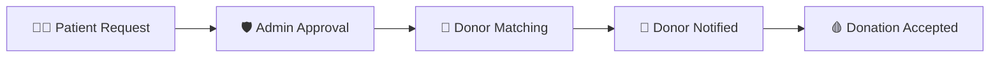

<div align="center">


<b><i>Connecting donors, patients & admins — Java Web App</i></b>


      

   
</div>

---

## 🩸 About the Project

A full-featured **Blood Donation Management System** built with **Java Servlets, JSP and MySQL** following the MVC + DAO pattern. It connects **donors**, **patients** and **administrators**: patients raise blood requests, admins approve users and match donors, and donors receive notifications and track their donation history.

## ✨ Key Features

- 👤 Three roles — **Donor, Patient, Admin** with secure login (`AuthFilter`)
- 📝 Donor & patient **registration with admin approval / rejection**
- 🆘 Patients create **blood requests** and track request status
- 🔎 Admin **matches donors** to requests by blood group
- 🔔 **Donor notifications** — accept or reject donation requests
- 📜 **Donation history**, profiles and admin **reports dashboard**

## 🧠 How It Works



## 🛠️ Tech Stack

| Layer | Technology |
|---|---|
| Backend | Java Servlets (MVC) + DAO layer |
| Views | JSP · HTML5 · CSS3 |
| Database | MySQL (JDBC) |
| Build / Server | Maven · Apache Tomcat |

## 📂 Project Structure

```text
Blood Donation Project/
├── pom.xml
└── src/main/
    ├── java/com/bloodbank/
    │   ├── controller/   # 25+ servlets (login, dashboards, requests, matching, reports)
    │   ├── dao/          # AdminDao, DonorDao, PatientDao, BloodRequestDao, ...
    │   ├── filter/       # AuthFilter
    │   └── listener/     # AppStartupListener
    └── webapp/           # JSP pages, CSS, assets
```

## 🚀 Getting Started

```bash
git clone https://github.com/PreciousBharath/BLOOD-DONATION.git
cd "BLOOD-DONATION/Blood Donation Project"
# 1. Create a MySQL database and update the DB credentials in the DAO/DB utility
mvn clean package
# 2. Deploy target/*.war to Apache Tomcat and open http://localhost:8080/
```

📄 Detailed project documentation is available in the `.docx` files and in `Blood Donation Project/README.md`.

## 🤝 Contributing

Contributions, issues and feature requests are welcome! Feel free to ⭐ star the repo and open a pull request.

## 👨‍💻 Author

<div align="center">

**Bharath** — Software Developer · Project Engineer · Technical Trainer

<a href="https://github.com/PreciousBharath"></a>
<a href="https://linkedin.com/in/connectbharath"></a>

### 🍔 EAT · 😴 SLEEP · 💻 CODE · 🔁 REPEAT

⭐ **If you found this project useful, give it a star!** ⭐


</div>
